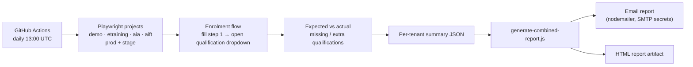

# Certified.io Frontend Automation

[](https://github.com/azkaiftikhar01/certifiedio-frontend-automation/actions/workflows/daily-tests.yml)

A Playwright + TypeScript health check for [Certified.io](https://certified.io), a
multi-tenant certification platform. Every day it walks the enrolment flow on each
tenant, in both production and staging, and checks that every qualification the
tenant sells actually shows up for a new student. Then it emails a combined report.


## Why I built it

Each tenant (training organisation) has its own catalogue of qualifications. When one
silently drops out of the enrolment dropdown, because of a config change, a bad deploy or a
data issue, nobody notices until a student can't enrol. Unit tests don't catch that, because
the code is fine and only the data per tenant is wrong. This suite checks what a student
really sees, in every environment, every day.

## How it works



- **One project per tenant and environment.** `playwright.config.ts` defines seven
  projects. Each one takes its base URL from a repository variable, so adding a tenant
  means adding one project and one spec.
- **Built for slow environments.** Staging can take minutes to wake up, so the
  qualification list is polled until it settles instead of failing on a fixed wait.
- **Diff, not just pass/fail.** Each run records the missing and extra qualifications,
  so the email says exactly what changed.
- **Page Object Model.** Shared pages live in `tests/pages/` and extend `BasePage`.
  `tests/utils/locatorSuggester.ts` ranks candidate locators (test id, then role, label,
  placeholder, text and finally CSS) for when the UI changes.

## Run it locally

```bash
npm ci
npx playwright install
npm run test:demo        # one tenant
npm run report:open      # HTML report
```

`npm test` runs every project. Base URLs default to the values in
`.github/workflows/daily-tests.yml` and can be overridden with `DEMO_URL`,
`ETRAINING_URL`, `AIA_URL`, `AIFT_URL` and their `_STAGE_URL` variants.

To send the email summary, set `SMTP_HOST`, `SMTP_PORT`, `SMTP_USER`, `SMTP_PASS`,
`MAIL_FROM` and `MAIL_TO`, then run `npm run report:email`.

## Layout

| Path | What |
|---|---|
| `tests/*-certifications.spec.ts` | One spec per tenant and environment |
| `tests/pages/` | Page objects (`BasePage`, `HomePage`, `LoginPage`) |
| `tests/utils/locatorSuggester.ts` | Ranks resilient locators for a page |
| `scripts/generate-combined-report.js` | Merges the per-tenant results |
| `scripts/send-health-check-report.js` | Emails the combined report |
| `.github/workflows/daily-tests.yml` | Daily schedule, plus a manual trigger |
